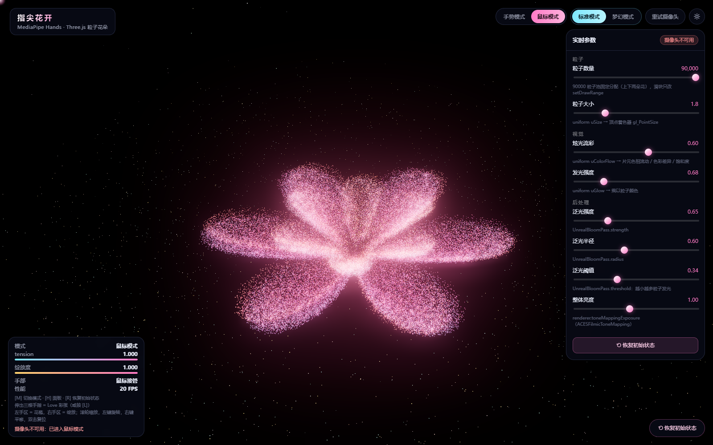

# 指尖花开 · 手势控制粒子花朵

用摄像头识别手部 21 个关键点，把「手掌张开度」映射成一朵 3D 粒子花的绽放程度。
握拳 → 粒子聚合、花苞闭合；张开五指 → 粒子扩散、花朵绽放。
摄像头不可用时自动切到鼠标模式，同样可以玩。

```
纯前端 · 无构建 · 原生 ES Module + CDN
Three.js r169   ·  MediaPipe Hands  ·  EffectComposer + UnrealBloomPass
```



---

## 1. 快速开始

必须走 HTTP（`file://` 下浏览器禁用摄像头）：

```bash
python -m http.server 5500 --bind 127.0.0.1
# 打开 http://127.0.0.1:5500/
```

首次进入浏览器会请求摄像头权限；拒绝也没关系，会自动进入鼠标模式。

**快捷键**

| 键 | 作用 |
|---|---|
| `M` | 手势模式 / 鼠标模式 切换 |
| `H` | 显示 / 隐藏参数面板 |
| `R` | 恢复初始状态（参数 + 视角 + 绽放度 + 模式） |

**鼠标模式操作**：左右移动 = 张力（左闭合、右绽放）· 上下移动 = 花朵俯仰 · 滚轮 = 缩放 0.5~2.0 · 左键拖拽 = 旋转 · 右键拖拽 = 平移 · 双击 = 复位视角。

---

## 2. 张力是怎么算出来的

设 `wrist = 关键点 0`：

```
D_palm = |0 → 9|                                   腕 → 中指 MCP（尺度基准）
D_tip  = mean( |0→4|, |0→8|, |0→12|, |0→16|, |0→20| )
raw    = D_tip / D_palm − 1                        握拳≈0，张开≈1
t_inst = clamp( clamp(raw × openGain, 0, 1) × gain, 0, 1 )
tension = 平滑(t_inst)
```

- **除以手掌尺寸**：手离镜头远近、画面位置都不影响读数（自检里有这两条断言）。
- **拇指取指尖 4 而不是关节 3**：握拳时关节 3 仍离腕较远，会让"握拳"读数偏高。
- **平滑**用帧率无关的指数衰减：`keep = (1−alpha)^(dt·60)`，30/60/120fps 衰减总量一致。

### 张力 → 绽放

```
t < 0.32           → bloom = 0      粒子聚合，花苞闭合
0.32 ≤ t ≤ 0.66    → 平滑过渡（smoothstep + 钟形包络）
t > 0.66           → bloom = 1      完全绽放
```

再套一层规格要求的缓动：`currentSpread += (targetSpread − currentSpread) * 0.1`。

---

## 3. 花朵几何：极坐标玫瑰曲线

粒子不在 CPU 上逐帧算位置，而是**建库时**把「花苞位置」和「绽放位置」两组坐标写进顶点属性，
运行时只改一个 `uBloom` uniform，顶点着色器插值：

```glsl
vec3 pos = mix(aPosBud, position, uBloom);   // position = 绽放位置
```

绽放时还会绕 Y 轴"拧"一下（`uSpin`），让花瓣像真的翻开。

**花瓣轮廓**用极坐标玫瑰曲线：

```
r(θ) = |cos(k·θ / 2)|^sharp          k = 花瓣数（默认 6）
```

`k` 个峰值就是 `k` 个花瓣；`sharp` 越大瓣越瘦、瓣间凹陷越深（默认 0.78）。
粒子半径用 `sqrt(random)` 采样 —— 这样粒子在**面积**上均匀，否则会全挤在圆心。

**三层结构**：外瓣（75%）+ 内瓣（25%，旋转 30°、半径 0.62、略微抬高）+ 花心金粉（7%）+ 飘散尘埃（6%）。

---

## 4. 视觉预设：标准模式 / 梦幻模式

右上角两个按钮，点一下就套用一整组参数（不重建场景、不重建几何体）：

| 预设 | 参数 | 观感 |
|---|---|---|
| **标准模式**（默认，打开页面就是它） | 粒子数量 **拉满 90000**，其余全默认（半径 0.60 / 阈值 0.34） | 光晕柔和，颗粒与花瓣层次都清楚 |
| **梦幻模式** | 粒子数量 **拉满 90000** + 泛光半径 **0** + 泛光阈值 **0** | 泛光最"贪"：所有粒子都参与发光，整朵花化成一团柔和的粉色光晕 |

- 切换只改参数表 `PARAM_DEFS` 里的值，然后走同一条 `applyParams()` 管线。
- 手动拖动任意滑块后，预设按钮的高亮会取消（表示现在是「自定义」）。
- 「恢复初始状态」（`R`）会回到**标准模式**。
- 选中的预设会跟着参数一起存进 localStorage，刷新后还在。

> 泛光半径 0 + 阈值 0 是这个后处理的极端配置：
> 半径 0 时 `UnrealBloomPass` 用最低一层 mip（1/16 分辨率）上采样，背景小亮星会带一点方块感；
> 阈值 0 则让**所有**粒子都参与泛光，画面会明显变"糊"、也更梦幻。
> 想要干净清晰，把半径拉到 0.3 以上、阈值拉到 0.3 左右。

## 5. 参数面板（实时生效，自动存 localStorage）

| 参数 | 范围 | 默认 | 映射到 |
|---|---|---|---|
| 粒子数量 | 1000 ~ 50000，步长 1000 | 40000 | `geometry.setDrawRange()`（**不重建几何体**） |
| 粒子大小 | 0.5 ~ 6.0 | 2.0 | `uniform uSize` → 顶点着色器 `gl_PointSize` |
| 炫光流彩 | 0 ~ 1 | 0.6 | `uniform uColorFlow` → 片元色相流动 / 色彩差异 / 饱和度 |
| 发光强度 | 0 ~ 3 | 1.2 | `uniform uGlow` → 乘以粒子颜色 |
| 泛光强度 | 0 ~ 2.5 | 0.8 | `UnrealBloomPass.strength` |
| 泛光半径 | 0 ~ 1.5 | 0.6 | `UnrealBloomPass.radius` |
| 泛光阈值 | 0 ~ 1 | 0.18 | `UnrealBloomPass.threshold` |
| 整体亮度 | 0.2 ~ 2.0 | 1.0 | `renderer.toneMappingExposure`（ACESFilmic） |

> 规格给的默认粒子数是 12000；这里默认 40000，是因为 12000 颗在这个尺寸下太稀，
> 看不出"花"。想省性能就把滑块拉低，50000 也完全跑得动（一次性建池，只改 drawRange）。

粒子池按 `MAX_PARTICLES = 50000` 一次性分配（`position` / `aPosBud` / `aColor` / `aInfo` = 44 B/顶点），
滑块只改 `drawRange.count`，所以拖动时**不卡顿、不重建**。

---

## 6. 渲染管线

```
RenderPass(摄像头背景)  →  RenderPass(粒子，clear:false)  →  UnrealBloomPass  →  OutputPass
```

- 摄像头画面画进一张 2D canvas 当纹理，`opacity 0.22` 半透明叠加在最底层（鼠标模式隐藏）。
- 骨架单独一层 canvas（21 点 + 连线，右手青蓝 / 左手品红）。
- 泛光阈值默认 0.18（很低）—— 这是"发光粒子花"观感的关键：几乎所有粒子都参与泛光，
  中心自然烧成金白色的核。
- `renderer.toneMappingExposure` 控制整体亮度，和泛光强度**分开**调（避免"想亮就糊"）。

---

## 7. 鼠标模式（与手势模式共用同一套粒子系统）

`activeMode` 决定 `targetTension` 的来源，场景、材质、着色器全部复用，不重建：

| 输入 | 效果 |
|---|---|
| 鼠标横向位置 | `targetTension = clientX / innerWidth` |
| 鼠标纵向位置 | 花朵俯仰 −0.3 ~ +0.3 弧度 |
| 滚轮 | 相机距离 / 缩放 0.5 ~ 2.0 |
| 左键拖拽 | 旋转视角 |
| 右键拖拽 | 平移视角 |
| 双击 | 复位视角 |

鼠标位置还有一颗跟随光点（DOM 元素，不进 WebGL），同时驱动着色器里的"指尖排斥"亮区。

---

## 8. 文件结构

```
gesture-flower/
├── index.html      画布三层（bg / overlay / gl）、HUD、面板、按钮
├── style.css       毛玻璃 UI、响应式、安全区、reduced-motion
├── main.js         §0 配置 §1 工具 §2 张力 §3 手势 §4 花朵 §5 舞台 §6 鼠标 §7 界面 §8 主程序
├── verify.mjs      离线自检：104 项（公式 / 参数表 / 预设 / 着色器 / DOM 契约）
└── docs/           截图与 GIF
```

---

## 9. 彩蛋：伸出三根手指 → "Love"

对着摄像头**伸出三根手指**（食指/中指/无名指/小指里任意三根，不含拇指），
停留 0.15 秒以上就会触发：

```
0.00 ~ 0.45s   整朵花的粒子淡出（消失）
0.45 ~ 5.05s   笔尖从左写到右，"Love" 一笔一笔被写出来（4.6 秒，慢一点才像在写）
5.05 ~ 7.45s   停住
7.45 ~ 8.35s   文字淡出，花回来
```

时长都集中在 `LOVE_TIMING` 这一个常量里，想快想慢改一行：

```js
const LOVE_TIMING = { vanish: 0.45, write: 4.60, hold: 2.40, return: 0.90 };
```

几个实现要点：

- 文字用**独立的粒子点云**（`LoveField`），不跟着花一起倾斜 —— 花在
  `flower.group` 里，那个组是 rotation.x = 0.42 的，文字塞进去会被拧歪。
- 文字形状是先把 `Love` 画到离屏 canvas，再**逐像素采样**成 3D 坐标
  （手写体优先：Segoe Script → Brush Script MT → Georgia）。
- 每颗粒子存两个额外属性：`aFrom`（起飞点，花附近）和 `aRank`（书写顺序，按 x 归一化）。
  顶点着色器里 `pen = (uReveal*1.18 - aRank)/0.10`，笔尖扫过它才从 `aFrom` 飞到位，
  所以是"汇聚"出来的，不是直接出现。
- 笔尖附近（`vTip` 大）颜色偏白偏亮，写完的字是暖粉色。
- 冷却 7 秒，避免手一直举着三根指头就反复播放。
- 也可以直接按 **`L`** 手动触发（演示时比手势可靠）。
## 10. 离线自检

```bash
node verify.mjs        # 104 项断言，不依赖浏览器和网络
```

覆盖：

- 张力公式（张开 > 握拳、尺度归一化、位置归一化、gain 线性）
- 张力 → 绽放（两端点、单调性、值域）
- 缓动（0.1 系数、无过冲、指数收敛）与 `damp`（负 dt / NaN dt 防护、帧率无关）
- 参数表与规格逐项对齐（范围、步长、`MAX_PARTICLES`、`setDrawRange`、localStorage）
- 玫瑰曲线的瓣数（k=5/6/7 实测峰值数）
- 着色器（varying 一致、uniform 都在 JS、`uSize`/`uGlow`/`uColorFlow` 落位、属性齐全）
- DOM 契约（main.js 引用的 id 都在 HTML 里）、快捷键、鼠标映射、摄像头错误分支

---

## 11. 已知限制

- 加法混合没有遮挡关系：粒子越多中心越亮，靠 `uColorFlow` 与离轴衰减保住颜色，不是照片级花瓣。
- 极坐标玫瑰曲线是**平面**花瓣；想要卷曲的立体花瓣，得换成参数曲面网格（本仓库早期的
  `仙子之吻` 版本就是这么做的，代价是失去"粒子感"）。
- MediaPipe Hands 走 CDN，首次加载需要网络；断网时手部识别不可用，但鼠标模式照常。
- `prefers-reduced-motion` 下只关掉 UI 过渡，粒子动画仍在跑（它是主体内容）。